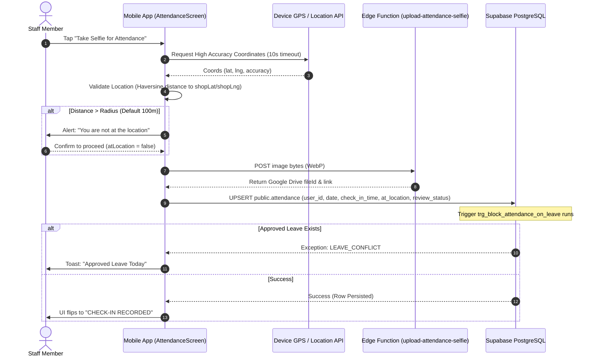
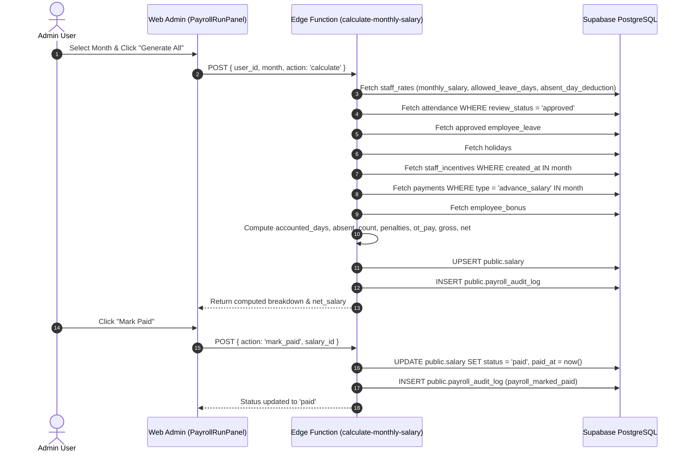

# Full Audit Report: Attendance & Salary/Payroll Modules

**Target System:** RepairShopApp (React/Next.js Admin Panel + Expo React Native Mobile App + Supabase Backend)  
**Audit Conducted:** 2026-10-24  
**Audit Mode:** Read-Only Source Code Inspection, AST & Schema Analysis (Gravitas Standard)  
**Auditor:** Principal Software Engineer, Security Reviewer, Database Architect & Payroll-Systems QA Specialist  

---

## 1. Executive Summary

### 1.1 Overall Health Scores (0 – 10 Scale)

| Module | Health Score | Status | Primary Weakness |
| :--- | :---: | :---: | :--- |
| **Attendance Module** | **4.2 / 10** | ⚠️ High Risk | Client-side geofencing, open RLS update policy allowing staff self-approval, lack of server-side GPS validation. |
| **Salary / Payroll Module** | **3.8 / 10** | 🚨 Critical Risk | Broken mobile admin "Mark as Paid", non-frozen paid payroll runs, triplicated divergent calculation formulas. |
| **Integration Points** | **4.5 / 10** | ⚠️ High Risk | Mobile "Mark Leave" marks unexcused absence in salary engine; multi-tech incentive split loses remainder cents and distorts past months upon tech reassignment. |
| **Overall System Health** | **4.1 / 10** | ⚠️ Needs Remediation | Significant vulnerabilities in RLS, lack of server-side enforcement, financial integrity risks in payroll. |

### 1.2 Findings by Severity

```
  CRITICAL: 5  █████
      HIGH: 5  █████
    MEDIUM: 6  ██████
       LOW: 4  ████
     TOTAL: 20 Findings
```

### 1.3 Top 5 Most Urgent Issues

1. **[CRITICAL] Privilege Escalation via Open Column Update on `users` Table (`SEC-001`)**  
   The RLS policy `users_update_own_profile` on `public.users` allows any authenticated user to update their own row without column restrictions. Any technician or receptionist can issue `UPDATE users SET role = 'admin', is_active = true WHERE id = auth.uid()` via the client Supabase SDK and grant themselves full administrative control over the entire system.

2. **[CRITICAL] Client-Controlled Attendance Update Allows Staff to Falsify Hours and Self-Approve Out-of-Location Check-Ins (`SEC-002`)**  
   The RLS policy `attendance_update` permits any staff member to update their own attendance row. Any technician can send arbitrary `check_in_time`, `check_out_time`, `at_location: true`, `review_status: 'approved'`, `status: 'Present'`, and `ot_hours: 5`, completely bypassing geofencing, manager review, and inflating their salary without detection.

3. **[CRITICAL] Geofence Validation is Entirely Client-Side with Zero Server-Side Enforcement (`SEC-003`)**  
   The 40 m / 100 m geofence check is implemented only as a JavaScript Haversine check in React Native (`AttendanceScreen.tsx`). The database has no trigger, check constraint, or RPC verifying GPS coordinates against `geofence_settings`. Any client can check in from hundreds of kilometers away and set `at_location: true`.

4. **[CRITICAL] Mobile Admin "Mark as Paid" is Broken and Crashes Due to Schema Mismatch (`SAL-001`)**  
   In `RepairShopApp/src/screens/admin/SalaryScreen.tsx`, tapping "Mark as Paid" does not set `status: 'paid'` on update, and on new records it attempts to insert into `allowed_leave_days` on `public.salary`. Because the database column is named `allowed_leave_days_snap`, PostgreSQL throws a runtime error `column "allowed_leave_days" does not exist`, completely breaking mobile payroll finalization.

5. **[CRITICAL] Closed / Paid Salary Records Are Not Frozen and Are Silently Overwritten (`SAL-002`)**  
   In `supabase/functions/calculate-monthly-salary/index.ts`, generating payroll for a past month does not check if `status === 'paid'`. It overwrites the existing record with newly recomputed figures based on current rates and logs. If admin changes staff rates or attendance months later, historical paid payroll records are mutated, destroying financial audit trails.

---

## 2. Scope & Method

### 2.1 What Was Reviewed
- **Database Layer**: All 53 Supabase migrations in [`supabase/migrations/`](file:///d:/Digital%20Solution/supabase/migrations), squashed baseline schema (`20260819000000_baseline_schema.sql`), active triggers, security definer functions, RPCs, and RLS policies on `users`, `attendance`, `salary`, `staff_rates`, `staff_incentives`, `payments`, `employee_leave`, `employee_bonus`, `holidays`, `geofence_settings`, `payroll_audit_log`.
- **Backend / Edge Functions**: [`supabase/functions/calculate-monthly-salary/index.ts`](file:///d:/Digital%20Solution/supabase/functions/calculate-monthly-salary/index.ts), [`upload-attendance-selfie/index.ts`](file:///d:/Digital%20Solution/supabase/functions/upload-attendance-selfie/index.ts), [`export-attendance-reports/index.ts`](file:///d:/Digital%20Solution/supabase/functions/export-attendance-reports/index.ts), [`notify-on-late-checkin/index.ts`](file:///d:/Digital%20Solution/supabase/functions/notify-on-late-checkin/index.ts), [`notify-on-leave-event/index.ts`](file:///d:/Digital%20Solution/supabase/functions/notify-on-leave-event/index.ts).
- **Web Admin Panel (Next.js App Router)**: [`admin-panel/src/app/(admin)/attendance/page.tsx`](file:///d:/Digital%20Solution/admin-panel/src/app/(admin)/attendance/page.tsx), [`admin-panel/src/app/(admin)/salary/page.tsx`](file:///d:/Digital%20Solution/admin-panel/src/app/(admin)/salary/page.tsx), [`admin-panel/src/app/(admin)/settings/geofence/page.tsx`](file:///d:/Digital%20Solution/admin-panel/src/app/(admin)/settings/geofence/page.tsx), [`admin-panel/src/components/salary/*`](file:///d:/Digital%20Solution/admin-panel/src/components/salary), [`admin-panel/src/components/attendance/*`](file:///d:/Digital%20Solution/admin-panel/src/components/attendance), [`admin-panel/src/utils/salary.ts`](file:///d:/Digital%20Solution/admin-panel/src/utils/salary.ts).
- **Mobile App (Expo React Native)**: [`RepairShopApp/src/screens/shared/AttendanceScreen.tsx`](file:///d:/Digital%20Solution/RepairShopApp/src/screens/shared/AttendanceScreen.tsx), [`RepairShopApp/src/screens/admin/StaffAttendanceOverviewScreen.tsx`](file:///d:/Digital%20Solution/RepairShopApp/src/screens/admin/StaffAttendanceOverviewScreen.tsx), [`RepairShopApp/src/screens/admin/SalaryScreen.tsx`](file:///d:/Digital%20Solution/RepairShopApp/src/screens/admin/SalaryScreen.tsx), [`RepairShopApp/src/screens/shared/SalaryScreen.tsx`](file:///d:/Digital%20Solution/RepairShopApp/src/screens/shared/SalaryScreen.tsx), [`RepairShopApp/src/components/shared/SelfieCapture.tsx`](file:///d:/Digital%20Solution/RepairShopApp/src/components/shared/SelfieCapture.tsx), [`RepairShopApp/src/utils/distance.ts`](file:///d:/Digital%20Solution/RepairShopApp/src/utils/distance.ts).
- **Shared Packages & Tests**: [`packages/shared/src/incentive.ts`](file:///d:/Digital%20Solution/packages/shared/src/incentive.ts), [`packages/shared/src/date.ts`](file:///d:/Digital%20Solution/packages/shared/src/date.ts), [`packages/shared/src/payroll.test.ts`](file:///d:/Digital%20Solution/packages/shared/src/payroll.test.ts), [`admin-panel/src/utils/salary.test.ts`](file:///d:/Digital%20Solution/admin-panel/src/utils/salary.test.ts).

### 2.2 Unverified / Needs Manual Check
1. **Physical Hardware Camera & GPS Permissions**: Behavior when device location services are globally disabled at the OS level vs app-level permission denied was verified via code inspection of `Location.hasServicesEnabledAsync()` and `Location.getCurrentPositionAsync()`; real-device behavior on physical Android 14/15 and iOS 18 hardware requires physical device test.
2. **Google Drive API Quotas & Token Expiry**: The backend uses Google Drive Service Account credentials via `getAccessToken()` for storing selfie files instead of Supabase Storage. Drive rate limits and token caching under high concurrency require live load verification.

### 2.3 Core System Assumptions
- Business operates exclusively in Indian Standard Time (IST, UTC+05:30).
- Normal working shift is Monday through Saturday, 10:30 AM to 7:00 PM IST (cut-off check-in at 10:30 AM).
- Geofence check is intended to enforce a 40-meter radius around the shop coordinates.

---

## 3. System Map

### 3.1 Inventory Table

| Path | Type | Platform | Purpose | Tables / RPCs Touched |
| :--- | :--- | :--- | :--- | :--- |
| `supabase/migrations/20260819000000_baseline_schema.sql` | Migration | Backend | Schema, RLS, triggers, functions | `attendance`, `salary`, `staff_rates`, `geofence_settings`, `employee_leave`, `employee_bonus`, `payments` |
| `supabase/migrations/20260821000000_salary_engine_schema_fixes.sql` | Migration | Backend | DB trigger blocking attendance on leave, rate columns | `attendance`, `employee_leave`, `staff_rates`, `salary`, RPC `check_leave_conflict` |
| `supabase/migrations/20260821400000_salary_rpcs_and_staff_rates_schema_fixes.sql` | Migration | Backend | Security definer RPCs for advances & bonuses | `payments`, `employee_bonus`, `payroll_audit_log`, RPC `record_advance_salary`, RPC `record_bonus` |
| `supabase/migrations/20260822110000_multi_technician_equal_incentive.sql` | Migration | Backend | Equal incentive division trigger & assignment RPC | `job_technicians`, `staff_incentives`, `jobs`, RPC `assign_job_technicians` |
| `supabase/functions/calculate-monthly-salary/index.ts` | Edge Function | Backend | Core monthly payroll computation & persistence | `users`, `staff_rates`, `attendance`, `employee_leave`, `holidays`, `payments`, `staff_incentives`, `employee_bonus`, `salary`, `payroll_audit_log` |
| `supabase/functions/upload-attendance-selfie/index.ts` | Edge Function | Backend | Google Drive upload for check-in/out photos | Google Drive API, `STAFF_ATTENDCE_IMG` folder |
| `packages/shared/src/incentive.ts` | Util | Shared | TypeScript incentive splitter with penny remainder handling | Pure utility |
| `packages/shared/src/date.ts` | Util | Shared | IST date formatting & time math | Pure utility |
| `admin-panel/src/app/(admin)/attendance/page.tsx` | Page | Web Admin | Staff attendance monitoring, selfie preview, review approval | `attendance`, `users` |
| `admin-panel/src/app/(admin)/salary/page.tsx` | Page | Web Admin | Salary dashboard container with 7 sub-tabs | `users` |
| `admin-panel/src/app/(admin)/settings/geofence/page.tsx` | Page | Web Admin | Map pin geofence coordinator & radius setup | `geofence_settings` |
| `admin-panel/src/components/settings/GeofenceMap.tsx` | Component | Web Admin | Interactive Leaflet map with drag/pin and Nominatim search | Browser Geolocation, Leaflet |
| `admin-panel/src/components/salary/PayrollRunPanel.tsx` | Component | Web Admin | Batch payroll generation, regeneration & mark paid | `salary`, calls Edge Function `calculate-monthly-salary` |
| `admin-panel/src/components/salary/SalaryCalculatorForm.tsx` | Component | Web Admin | Live preview calculator | Calls Edge Function `calculate-monthly-salary` |
| `admin-panel/src/components/salary/StaffRateForm.tsx` | Component | Web Admin | Admin configuration of per-staff pay rates & penalties | `staff_rates` |
| `admin-panel/src/components/salary/AdvanceSalaryForm.tsx` | Component | Web Admin | Admin recording of advance salaries | RPC `record_advance_salary` |
| `admin-panel/src/components/salary/LeaveManagement.tsx` | Component | Web Admin | Leave application review and approval | `employee_leave` |
| `admin-panel/src/components/salary/HolidayCalendarForm.tsx` | Component | Web Admin | Organization holiday configuration | `holidays` |
| `admin-panel/src/components/salary/BonusForm.tsx` | Component | Web Admin | One-off bonus recording | RPC `record_bonus` |
| `admin-panel/src/utils/salary.ts` | Util | Web Admin | Client-side salary formula calculator | Pure utility |
| `RepairShopApp/src/screens/shared/AttendanceScreen.tsx` | Screen | Mobile | Check-in/out, camera selfie capture, calendar history | `attendance`, `geofence_settings`, RPC `check_leave_conflict` |
| `RepairShopApp/src/screens/admin/StaffAttendanceOverviewScreen.tsx` | Screen | Mobile Admin | Daily staff attendance summary list | `users`, `attendance` |
| `RepairShopApp/src/screens/admin/SalaryScreen.tsx` | Screen | Mobile Admin | Mobile admin salary calculation and manual persistence | `users`, `salary`, calls Edge Function `calculate-monthly-salary` |
| `RepairShopApp/src/screens/shared/SalaryScreen.tsx` | Screen | Mobile Shared | Staff view of salary breakdown and leave requests | `staff_rates`, `salary`, `employee_leave`, calls Edge Function `calculate-monthly-salary` |
| `RepairShopApp/src/components/shared/SelfieCapture.tsx` | Component | Mobile | Camera preview, GPS acquisition, WebP compression | Expo Camera, Expo Location, Edge Function `upload-attendance-selfie` |
| `RepairShopApp/src/utils/distance.ts` | Util | Mobile | Haversine distance calculator | Pure utility |

### 3.2 Duplicate and Near-Duplicate Files

1. **`RepairShopApp/src/screens/admin/SalaryScreen.tsx` vs `RepairShopApp/src/screens/shared/SalaryScreen.tsx`**  
   - Two separate salary screens exist in the mobile app.
   - `admin/SalaryScreen.tsx` (503 lines): Contains broken manual insert/update logic for marking paid (`SAL-001`).
   - `shared/SalaryScreen.tsx` (439 lines): Displays staff payslips and leave request forms, but queries `public.salary` which is blocked by RLS for staff (`SAL-006`).
2. **`admin-panel/src/utils/salary.ts` vs `supabase/functions/calculate-monthly-salary/index.ts`**  
   - Duplicated and divergent salary computation algorithms (`SAL-003`).

### 3.3 Route Map & Role Permissions

| Platform | Route / Screen | File | Accessible By | Role Guard Present |
| :--- | :--- | :--- | :--- | :--- |
| **Web Admin** | `/attendance` | `app/(admin)/attendance/page.tsx` | Admin, Receptionist | Layout guard: `admin`, `receptionist` (`Sidebar.tsx:101-104` does not hide `/attendance` from receptionist) |
| **Web Admin** | `/salary` | `app/(admin)/salary/page.tsx` | Admin | Explicit page guard (`role !== 'admin' -> Access Denied`) |
| **Web Admin** | `/settings/geofence` | `app/(admin)/settings/geofence/page.tsx` | Admin | Sidebar hides from receptionist; layout allows |
| **Mobile** | `Attendance` | `screens/shared/AttendanceScreen.tsx` | Admin, Receptionist, Technician | Mounted on `AdminTabs`, `ReceptionistTabs`, `TechnicianTabs` |
| **Mobile** | `StaffAttendanceOverview` | `screens/admin/StaffAttendanceOverviewScreen.tsx` | Admin | Mounted on `AdminStack` |
| **Mobile** | `Salary` (Admin) | `screens/admin/SalaryScreen.tsx` | Admin | Mounted on `AdminStack` |
| **Mobile** | `Salary` (Shared) | `screens/shared/SalaryScreen.tsx` | Receptionist, Technician | Mounted on `ReceptionistTabs`, `TechnicianTabs` |

### 3.4 Data Flow Diagrams

#### Check-In Lifecycle Data Flow


#### Salary Generation Data Flow


---

## 4. Findings

### Finding SEC-001: Privilege Escalation via Open Column Update on `users` Table
- **Severity**: CRITICAL
- **Location**: [`supabase/migrations/20260819000000_baseline_schema.sql:856-859`](file:///d:/Digital%20Solution/supabase/migrations/20260819000000_baseline_schema.sql#L856-L859)
- **Evidence**:
  ```sql
  create policy "users_update_own_profile"
    on public.users for update to authenticated
    using ((select auth.uid()) = id)
    with check ((select auth.uid()) = id);
  ```
- **Why it's a problem**: The RLS policy permits an authenticated user to execute an `UPDATE` on their own row in `public.users` with no column restrictions. There is no trigger or check constraint preventing `role` or `is_active` mutation. Any logged-in technician or receptionist can issue:
  ```ts
  await supabase.from('users').update({ role: 'admin', is_active: true }).eq('id', user.id);
  ```
  Once updated, the `public.is_admin()` function returns `true`, granting full administrative access to all database tables, financial records, salary rates, and payments.
- **How to reproduce**: Log in as any technician account, run the update query above from DevTools or a test script, and inspect `role`. The user immediately passes `is_admin()` checks.
- **Recommended fix**: Revoke general update permissions and restrict user profile updates to non-sensitive columns (`phone`, `avatar_url`, `expo_push_token`) via a dedicated RPC, or enforce a `BEFORE UPDATE` trigger on `public.users` that raises an exception if `NEW.role IS DISTINCT FROM OLD.role` or `NEW.is_active IS DISTINCT FROM OLD.is_active` when `auth.uid()` is not an admin.
  ```sql
  CREATE OR REPLACE FUNCTION public.protect_user_roles()
  RETURNS trigger LANGUAGE plpgsql SECURITY DEFINER AS $$
  BEGIN
    IF (NEW.role IS DISTINCT FROM OLD.role OR NEW.is_active IS DISTINCT FROM OLD.is_active) THEN
      IF NOT (SELECT public.is_admin()) THEN
        RAISE EXCEPTION 'UNAUTHORIZED: Only administrators can modify roles or active status.';
      END IF;
    END IF;
    RETURN NEW;
  END;
  $$;
  CREATE TRIGGER trg_protect_user_roles
  BEFORE UPDATE ON public.users
  FOR EACH ROW EXECUTE FUNCTION public.protect_user_roles();
  ```
- **Effort**: S

---

### Finding SEC-002: Client-Controlled Attendance Update Allows Staff to Falsify Times, Status, and Self-Approve Check-Ins
- **Severity**: CRITICAL
- **Location**: [`supabase/migrations/20260819000000_baseline_schema.sql:913-916`](file:///d:/Digital%20Solution/supabase/migrations/20260819000000_baseline_schema.sql#L913-L916)
- **Evidence**:
  ```sql
  create policy "attendance_update"
    on public.attendance for update to authenticated
    using ((select auth.uid()) = user_id or (select public.is_admin()))
    with check ((select auth.uid()) = user_id or (select public.is_admin()));
  ```
- **Why it's a problem**: Any staff member can update any column on their own `attendance` record via the Supabase client SDK. A technician who arrived late at 11:45 AM or checked in from outside the geofence can issue:
  ```ts
  await supabase.from('attendance').update({
    check_in_time: '2026-10-24T05:00:00.000Z', -- 10:30 AM IST
    check_out_time: '2026-10-24T13:30:00.000Z', -- 19:00 PM IST
    at_location: true,
    review_status: 'approved',
    status: 'Present',
    late_in_minutes: 0,
    ot_hours: 4
  }).eq('user_id', user.id).eq('date', todayStr);
  ```
  PostgreSQL accepts the update unconditionally. Because the salary engine (`calculate-monthly-salary:221`) counts all rows with `review_status = 'approved'`, the staff member successfully self-approves their attendance and extracts unearned overtime pay.
- **How to reproduce**: Log in as a technician on mobile or via script, check in out of location (`review_status = 'pending'`), then execute `supabase.from('attendance').update({ review_status: 'approved', at_location: true }).eq('id', recordId)`. The query succeeds.
- **Recommended fix**: Drop direct `UPDATE` permissions on `public.attendance` for non-admin users. Perform check-in and check-out strictly through security-definer PostgreSQL functions (`record_staff_checkin`, `record_staff_checkout`), where timestamps use server `now()`, and `review_status` can only be altered by `is_admin()`.
- **Effort**: M

---

### Finding SEC-003: Geofence Validation is Entirely Client-Side with Zero Server-Side Enforcement
- **Severity**: CRITICAL
- **Location**: [`RepairShopApp/src/screens/shared/AttendanceScreen.tsx:284-358`](file:///d:/Digital%20Solution/RepairShopApp/src/screens/shared/AttendanceScreen.tsx#L284-L358) & [`RepairShopApp/src/utils/distance.ts:4-25`](file:///d:/Digital%20Solution/RepairShopApp/src/utils/distance.ts#L4-L25)
- **Evidence**:
  ```ts
  // AttendanceScreen.tsx:297
  const distance = getDistanceInMeters(lat, lng, shopLat, shopLng);
  if (distance > shopRadius) {
    // prompts Alert dialog
  } else {
    resolve({ proceed: true, atLocation: true });
  }
  ```
  And in `handleCaptureComplete`:
  ```ts
  // AttendanceScreen.tsx:328-329
  const isAtLocation = (data.atLocation ?? true) && !data.lowAccuracy;
  const reviewStatus = isAtLocation ? 'approved' : 'pending';
  ```
- **Why it's a problem**: The server has no knowledge of whether the coordinates sent by the mobile device are within the geofence or not. The client decides `at_location: true` and `review_status: 'approved'`. If an employee uses an Android mock location app, sends coordinates of the shop, or directly calls the REST API with `at_location: true`, the database accepts it.
- **How to reproduce**: Send an HTTP POST to `/rest/v1/attendance` with GPS coordinates 500 km away but payload containing `at_location: true` and `review_status: 'approved'`. The row is stored as an approved on-site check-in.
- **Recommended fix**: Move geofence distance calculation to a PostgreSQL server function or trigger. The trigger must fetch the active `geofence_settings`, calculate the Haversine distance from `NEW.gps_lat, NEW.gps_lng` to `center_lat, center_lng`, and enforce `NEW.at_location := (distance <= radius_meters)`. If `at_location = false`, force `NEW.review_status := 'pending'`.
- **Effort**: M

---

### Finding SAL-001: Mobile Admin "Mark as Paid" Fails to Set Status and Crashes on Insert
- **Severity**: CRITICAL
- **Location**: [`RepairShopApp/src/screens/admin/SalaryScreen.tsx:142-175`](file:///d:/Digital%20Solution/RepairShopApp/src/screens/admin/SalaryScreen.tsx#L142-L175)
- **Evidence**:
  ```ts
  // Line 142: Update existing record
  const { error } = await supabase
    .from('salary')
    .update({
      gross_salary: breakdown.gross_salary,
      net_salary: breakdown.net_salary,
      advance_deducted: breakdown.advance_deducted,
      present_days: breakdown.present_days,
      halfday_count: breakdown.halfday_count,
      ot_hours: breakdown.ot_hours,
      incentive_amount: breakdown.incentive_pay,
    })
    .eq('id', breakdown.salary_id);

  // Line 157: Insert new record
  const { error } = await supabase.from('salary').insert({
    user_id: breakdown.user_id,
    month: `${month}-01`,
    monthly_salary_base: breakdown.base_pay,
    ...
    allowed_leave_days: 0, // <-- COLUMN DOES NOT EXIST ON TABLE
    ...
  });
  ```
- **Why it's a problem**:
  1. The update payload completely omits `status: 'paid'` and `paid_at`. The record remains in `'draft'` status in the database.
  2. The insert payload specifies `allowed_leave_days`. On `public.salary`, the column added by migration `20260821000000_salary_engine_schema_fixes.sql:54` is `allowed_leave_days_snap`. The insert fails with PostgreSQL error: `column "allowed_leave_days" of relation "salary" does not exist`.
  3. Mobile admin cannot mark any salary as paid.
- **How to reproduce**: Open the mobile app as admin, go to Salary Management, tap a staff member, and tap "Mark as Paid". Inspect network traffic / toast: save fails or leaves status as draft.
- **Recommended fix**: Remove direct client-side table writes from `RepairShopApp/src/screens/admin/SalaryScreen.tsx`. Delegate `mark_paid` to the Edge Function (`calculate-monthly-salary`), matching the web admin implementation in [`PayrollRunPanel.tsx:157-170`](file:///d:/Digital%20Solution/admin-panel/src/components/salary/PayrollRunPanel.tsx#L157-L170):
  ```ts
  await supabase.functions.invoke('calculate-monthly-salary', {
    body: { action: 'mark_paid', salary_id: breakdown.salary_id }
  });
  ```
- **Effort**: S

---

### Finding SAL-002: Closed / Paid Salary Records Are Not Frozen and Are Silently Overwritten
- **Severity**: CRITICAL
- **Location**: [`supabase/functions/calculate-monthly-salary/index.ts:385-440`](file:///d:/Digital%20Solution/supabase/functions/calculate-monthly-salary/index.ts#L385-L440)
- **Evidence**:
  ```ts
  const { data: existingSalary } = await adminClient
    .from('salary').select('id, status').eq('user_id', user_id).eq('month', `${month}-01`).maybeSingle();
  ...
  const salaryPayload = {
    ...
    status: existingSalary?.status === 'paid' ? 'paid' : 'draft',
    ...
  };
  if (action !== 'preview') {
    if (salary_id) {
      await adminClient.from('salary').update(salaryPayload).eq('id', salary_id);
    }
  ```
- **Why it's a problem**: When a payroll run is finalized and paid, its figures must become an immutable historical snapshot. In `calculate-monthly-salary`, if `action !== 'preview'`, calling calculate on a paid month re-executes all live attendance queries and overwrites the paid row with new values. If staff rates or attendance records are retroactively modified, past payslips and financial accounts change without warning.
- **How to reproduce**: Mark an employee's salary for August as `paid` (`net_salary: 20000`). Later, modify their `staff_rates` base pay to 25000. Re-run `calculate-monthly-salary` for August. August's `net_salary` changes to 25000 despite being already paid.
- **Recommended fix**: Block recalculation of paid salary records unless an explicit `force_recalculate: true` flag is passed by an admin with a mandatory reason logged in `payroll_audit_log`.
  ```ts
  if (existingSalary?.status === 'paid' && action !== 'preview' && !body.force_recalculate) {
    return json({ error: 'PAYROLL_LOCKED: This payroll period has been marked as paid and cannot be regenerated.' }, 400, corsHeaders);
  }
  ```
- **Effort**: S

---

### Finding SAL-003: Business Logic Discrepancy & Triplication: Three Different Salary Engines
- **Severity**: HIGH
- **Location**:
  - Backend: [`supabase/functions/calculate-monthly-salary/index.ts:366-383`](file:///d:/Digital%20Solution/supabase/functions/calculate-monthly-salary/index.ts#L366-L383)
  - Web Admin: [`admin-panel/src/utils/salary.ts:36-84`](file:///d:/Digital%20Solution/admin-panel/src/utils/salary.ts#L36-L84)
  - Tests: [`packages/shared/src/payroll.test.ts:40-60`](file:///d:/Digital%20Solution/packages/shared/src/payroll.test.ts#L40-L60)
  - Specification: [`GEMINI.md:168-182`](file:///d:/Digital%20Solution/GEMINI.md#L168-L182)
- **Evidence**:
  1. `admin-panel/src/utils/salary.ts`:
     - Computes customer review bonus (`avg_review_score >= 4.5 -> +bonus`) and penalty (`avg_review_score < 3.0 -> -penalty`).
     - Computes job completion bonus (`completed_jobs > threshold -> +bonus`).
     - Formula: `chargeable_absent = Math.max(0, full_absent_days - Math.max(0, allowed_leave_days - leave_count))`. Does not deduct `leave_deduction` separately.
  2. `calculate-monthly-salary/index.ts`:
     - Customer review bonus, review penalty, and job completion bonus are **hardcoded to 0** (`lines 411-416`).
     - Deducts both `leave_deduction = (leave_count - allowed_leave) * absent_day_deduction` AND `absence_deduction = (working_days - accounted_days) * absent_day_deduction`.
     - Uses tiered minute penalties (30 / 60 Rs capped at 60 Rs/day) for late/early.
  3. `GEMINI.md` & `payroll.test.ts`:
     - Uses daily wage formula: `present_pay = present_days * base_daily_rate`.
- **Why it's a problem**: The web preview in `SalaryCalculatorForm.tsx` shows employees bonuses/penalties that the backend Edge Function completely ignores. The test suite tests a third formula that doesn't match either implementation.
- **Recommended fix**: Consolidate all payroll calculation into a single shared TypeScript engine in `@repairshop/shared/src/payrollEngine.ts`. Import this engine into both `calculate-monthly-salary/index.ts` and `admin-panel/src/utils/salary.ts`, and run the test suite against this single source of truth.
- **Effort**: M

---

### Finding SAL-004: Multi-Technician Incentive Split Truncation: Remainder Paise Lost in SQL
- **Severity**: HIGH
- **Location**: [`supabase/migrations/20260822110000_multi_technician_equal_incentive.sql:42,158`](file:///d:/Digital%20Solution/supabase/migrations/20260822110000_multi_technician_equal_incentive.sql#L42) vs [`packages/shared/src/incentive.ts:36-50`](file:///d:/Digital%20Solution/packages/shared/src/incentive.ts#L36-L50)
- **Evidence**:
  - In PostgreSQL trigger `accrue_incentives`:
    ```sql
    v_split_amount := ROUND((v_total_incentive / v_tech_count)::numeric, 2);
    FOR v_tech IN SELECT technician_id FROM ... LOOP
      INSERT INTO public.staff_incentives (..., amount) VALUES (..., v_split_amount, now());
    END LOOP;
    ```
  - In `packages/shared/src/incentive.ts`:
    ```ts
    const splitBase = Math.floor((total / count) * 100) / 100;
    let remainingCents = Math.round((total - splitBase * count) * 100);
    // distributes remainingCents cent-by-cent to first technicians
    ```
- **Why it's a problem**:
  If a job has a ₹100 incentive and 3 technicians:
  - `ROUND(100 / 3, 2)` = ₹33.33.
  - Each technician receives ₹33.33.
  - Total recorded in database = 33.33 × 3 = ₹99.99.
  - ₹0.01 is permanently lost and never paid.
  With large volumes of jobs and technicians, unallocated remainder paise accumulate. More importantly, client-side preview in TypeScript does not match the actual records created by the PostgreSQL trigger.
- **Recommended fix**: Update `accrue_incentives()` in PostgreSQL to track remainder paise and distribute them to the first active technician:
  ```sql
  v_split_amount := FLOOR((v_total_incentive / v_tech_count) * 100) / 100;
  v_remainder := v_total_incentive - (v_split_amount * v_tech_count);
  v_index := 0;
  FOR v_tech IN SELECT technician_id FROM ... LOOP
    v_index := v_index + 1;
    INSERT INTO public.staff_incentives (..., amount)
    VALUES (..., CASE WHEN v_index = 1 THEN v_split_amount + v_remainder ELSE v_split_amount END, now());
  END LOOP;
  ```
- **Effort**: S

---

### Finding SAL-005: Technician Reassignment After Job Completion Distorts Past Closed Payroll
- **Severity**: HIGH
- **Location**: [`supabase/migrations/20260822110000_multi_technician_equal_incentive.sql:151-168`](file:///d:/Digital%20Solution/supabase/migrations/20260822110000_multi_technician_equal_incentive.sql#L151-L168) & [`supabase/functions/calculate-monthly-salary/index.ts:347-349`](file:///d:/Digital%20Solution/supabase/functions/calculate-monthly-salary/index.ts#L347-L349)
- **Evidence**:
  In `assign_job_technicians`:
  ```sql
  IF v_job.status = 'Completed' AND COALESCE(v_job.snap_technician_incentive, 0) > 0 THEN
    DELETE FROM public.staff_incentives WHERE job_id = p_job_id AND source_type = 'job';
    ...
    INSERT INTO public.staff_incentives (user_id, source_type, job_id, amount, accrued_at)
    VALUES (v_tech_id, 'job', p_job_id, v_split_amount, now());
  ```
  And in `calculate-monthly-salary`:
  ```ts
  .gte('created_at', `${dateStart}T00:00:00+05:30`)
  .lte('created_at', `${dateEnd}T23:59:59.999+05:30`);
  ```
- **Why it's a problem**: If a job was completed on September 28th and assigned to Technician A, Technician A accrued ₹500 incentive with `created_at` in September. In October, an admin reassigns technicians on that completed job. The trigger deletes the September record and inserts a new one with `created_at = now()` (October).
  1. September's payroll loses ₹500.
  2. October's payroll gains ₹500.
  3. If September's payroll was already paid, Technician A was paid ₹500 in September, and will now be paid ₹500 again in October (or new tech gets paid, creating an unrecoverable discrepancy).
- **Recommended fix**:
  1. Preserve original `created_at` / `accrued_at` timestamps from the completed job's `completed_at` timestamp rather than `now()`.
  2. Disallow reassignment of technicians on jobs where the associated payroll month is already marked `'paid'`.
- **Effort**: M

---

### Finding ATT-001: Mobile "Mark Leave" and "Mark Halfday" Treated as Unexcused Absences
- **Severity**: HIGH
- **Location**: [`RepairShopApp/src/screens/shared/AttendanceScreen.tsx:627-639, 781-785`](file:///d:/Digital%20Solution/RepairShopApp/src/screens/shared/AttendanceScreen.tsx#L627-L639) & [`supabase/functions/calculate-monthly-salary/index.ts:221`](file:///d:/Digital%20Solution/supabase/functions/calculate-monthly-salary/index.ts#L221)
- **Evidence**:
  In `AttendanceScreen.tsx`:
  ```ts
  const { error } = await supabase.from('attendance').upsert({
    user_id: user.id,
    date: todayStr,
    status: confirmAction.status // 'Leave' or 'Halfday'
  }, { onConflict: 'user_id, date' });
  ```
  In `calculate-monthly-salary/index.ts`:
  ```ts
  const { data: attendanceRows } = await adminClient
    .from('attendance')
    .select(...)
    .eq('user_id', user_id)
    .eq('review_status', 'approved') // <-- ONLY APPROVED ROWS FETCHED
  ```
- **Why it's a problem**: When staff mark "Leave" or "Half Day" via the buttons in `AttendanceScreen.tsx`, the row is created with `review_status: 'pending'` (default) and does NOT insert into `employee_leave`. When the salary engine runs, it fetches only rows where `review_status = 'approved'`. Because the row is pending, it is ignored:
  - `present_days` = 0
  - `halfday_count` = 0
  - `leave_count` = 0
  - `accounted_days` = 0
  - `absent_count = working_days - accounted_days` -> The staff member is penalized with a **Full Day Absence Deduction** instead of a half-day deduction or paid leave!
- **How to reproduce**: Tap "Mark Half Day" on the mobile app. Run monthly salary calculation in admin panel. Notice the half-day count is 0 and absent days increased by 1 with a full absent day deduction.
- **Recommended fix**:
  1. For Leave: route "Mark Leave" to the `employee_leave` table so admin can formally approve it.
  2. For Half Day: include pending review rows in the admin attendance review queue and allow admin to approve/reject half-day requests.
- **Effort**: M

---

### Finding ATT-002: Geofence Radius Mismatch: 100m/200m in Code vs 40m Requirement
- **Severity**: HIGH
- **Location**:
  - `RepairShopApp/src/screens/shared/AttendanceScreen.tsx:246, 292`
  - `admin-panel/src/app/(admin)/settings/geofence/page.tsx:19, 39, 119`
  - `admin-panel/src/components/settings/GeofenceMap.tsx:56`
  - `supabase/migrations/20260819000000_baseline_schema.sql:613`
- **Evidence**:
  - `baseline_schema.sql:613`: `radius_meters integer not null default 200`
  - `AttendanceScreen.tsx:246`: `const radiusMeters = Number(geofenceData.radius_meters ?? 100);`
  - `geofence/page.tsx:19`: `const [radius, setRadius] = useState(100);`
- **Why it's a problem**: The system requirement specifically dictates a **40 m** geofence radius. The database defaults to 200 m, and all frontend applications default/fallback to 100 m. Staff checking in from neighbouring buildings 90 meters away are automatically classified as `at_location: true` and `review_status: 'approved'`.
- **Recommended fix**: Change database column default to 40 m in `geofence_settings` and update all client fallback constants from 100/200 to 40.
- **Effort**: S

---

### Finding ATT-003: Client Timestamp Spoofing for Check-In and Check-Out
- **Severity**: MEDIUM
- **Location**: [`RepairShopApp/src/screens/shared/AttendanceScreen.tsx:335, 348`](file:///d:/Digital%20Solution/RepairShopApp/src/screens/shared/AttendanceScreen.tsx#L335)
- **Evidence**:
  ```ts
  check_in_time: new Date().toISOString(),
  ...
  check_out_time: new Date().toISOString(),
  ```
- **Why it's a problem**: Timestamps are generated by the device's clock. If an employee arrives at 10:50 AM (past the 10:30 AM late cut-off), they can change their device system time to 10:20 AM before opening the app. The client sends the falsified timestamp to Supabase, completely evading late arrival penalty deductions.
- **Recommended fix**: Never accept check-in or check-out times from the client payload. Use PostgreSQL server time `now()` inside security definer RPCs (`record_checkin` / `record_checkout`).
- **Effort**: S

---

### Finding ATT-004: Mobile Admin Attendance Overview Lacks Parity: Missing At-Location Indicator & Uses Local Timezone
- **Severity**: MEDIUM
- **Location**: [`RepairShopApp/src/screens/admin/StaffAttendanceOverviewScreen.tsx:184-193`](file:///d:/Digital%20Solution/RepairShopApp/src/screens/admin/StaffAttendanceOverviewScreen.tsx#L184-L193)
- **Evidence**:
  ```ts
  if (att.check_in_time) {
    const checkInDate = new Date(att.check_in_time);
    const hours = checkInDate.getHours();
    const minutes = checkInDate.getMinutes();
    if (hours > 10 || (hours === 10 && minutes > 30) || ...) {
      isLate = true;
    }
  }
  ```
  And `at_location` / `review_status` are not selected from `public.attendance` in `loadData()` (`lines 154-158`).
- **Why it's a problem**:
  1. `checkInDate.getHours()` evaluates against device local timezone. If an admin travels or device is set to UTC, 10:30 AM IST (05:00 UTC) evaluates `hours = 5`, falsely marking everyone as on-time.
  2. Mobile admin dashboard has no green "at location" indicator, no review actions (allow/deny out-of-location attendance), and no parity with the web admin attendance page.
- **Recommended fix**: Select `at_location` and `review_status` in `loadData()`, calculate IST hour using `(checkInDate.getUTCHours() * 60 + checkInDate.getUTCMinutes() + 330) % 1440`, display green/amber location status badges, and add approve/deny action buttons.
- **Effort**: M

---

### Finding ATT-005: Midnight-Crossing Shifts and Forgotten Check-outs Leave Indefinite NULL Check-outs
- **Severity**: MEDIUM
- **Location**: [`RepairShopApp/src/screens/shared/AttendanceScreen.tsx:218, 555-585`](file:///d:/Digital%20Solution/RepairShopApp/src/screens/shared/AttendanceScreen.tsx#L218)
- **Evidence**:
  `todayStr = getAttendanceDateIST()` binds all queries to current calendar day.
- **Why it's a problem**:
  1. If a technician checks in at 11:00 PM and works until 1:00 AM, opening the app at 1:00 AM queries the new date, finds no check-in, and renders "Take Check-in Selfie". The previous shift's `check_out_time` remains permanently `NULL`.
  2. If an employee forgets to check out, `check_out_time` is `NULL`. While the Edge Function records `missing_checkout_count`, there is no automated shift closing mechanism or reminder notification.
- **Recommended fix**: Query for an active open shift (`check_in_time IS NOT NULL AND check_out_time IS NULL`) within the past 18 hours regardless of calendar day boundary. Implement a nightly pg_cron job at 04:00 IST to auto-close unclosed shifts with a flag `auto_closed: true`.
- **Effort**: M

---

### Finding ATT-006: Admin Attendance Approval Lacks Audit Trail (`approved_by` Never Recorded)
- **Severity**: MEDIUM
- **Location**: [`admin-panel/src/app/(admin)/attendance/page.tsx:141-154`](file:///d:/Digital%20Solution/admin-panel/src/app/(admin)/attendance/page.tsx#L141-L154)
- **Evidence**:
  ```ts
  const { error } = await supabase
    .from('attendance')
    .update({ review_status: newStatus })
    .eq('id', id);
  ```
- **Why it's a problem**: Table `attendance` has an `approved_by uuid references public.users(id)` column, but the review action in `attendance/page.tsx` never writes to it. There is no record of which admin approved an out-of-location or weak-GPS attendance record.
- **Recommended fix**: Include `approved_by: sessionUser.id` and timestamp `approved_at: new Date().toISOString()` in the update payload.
- **Effort**: S

---

### Finding SAL-006: Non-Admin Staff Blocked from Viewing Own Salary History by Strict RLS Policy
- **Severity**: MEDIUM
- **Location**: [`supabase/migrations/20260819000000_baseline_schema.sql:1094-1096`](file:///d:/Digital%20Solution/supabase/migrations/20260819000000_baseline_schema.sql#L1094-L1096) & [`RepairShopApp/src/screens/shared/SalaryScreen.tsx:180, 207`](file:///d:/Digital%20Solution/RepairShopApp/src/screens/shared/SalaryScreen.tsx#L180)
- **Evidence**:
  ```sql
  create policy "salary_admin_only"
    on public.salary for all to authenticated
    using ((select public.is_admin()));
  ```
- **Why it's a problem**: `RepairShopApp/src/screens/shared/SalaryScreen.tsx` is mounted on both `TechnicianTabs` and `ReceptionistTabs` to show staff their payslips. It attempts to query `supabase.from('salary').select('*').eq('user_id', user.id)`. Because only admin can SELECT from `salary`, the query returns 0 rows. Staff can only see an estimated live preview generated by the Edge Function, never their actual finalized past salary slips.
- **Recommended fix**: Add a SELECT RLS policy on `public.salary` allowing staff to view their own finalized salary records:
  ```sql
  CREATE POLICY "salary_own_select"
    ON public.salary FOR SELECT TO authenticated
    USING (user_id = (SELECT auth.uid()));
  ```
- **Effort**: S

---

### Finding SAL-007: Advance Salary Has No Carry-Forward Mechanism: Excess Advances Lost
- **Severity**: MEDIUM
- **Location**: [`supabase/functions/calculate-monthly-salary/index.ts:373-382`](file:///d:/Digital%20Solution/supabase/functions/calculate-monthly-salary/index.ts#L373-L382)
- **Evidence**:
  ```ts
  const { data: advanceRows } = await adminClient
    .from('payments').select('amount').eq('user_id', user_id).eq('type', 'advance_salary')
    .gte('created_at', `${dateStart}T00:00:00+05:30`)
    .lte('created_at', `${dateEnd}T23:59:59.999+05:30`);
  ...
  const net_salary = Math.max(0, Math.round((gross_salary - advance_deducted) * 100) / 100);
  ```
- **Why it's a problem**:
  1. Advances are strictly filtered within the calendar month. If an advance is recorded on the 31st of the month at 11:30 PM, it is not deducted from next month's payroll.
  2. If an employee takes ₹15,000 advance, but their net earnings for that month are only ₹10,000, `net_salary` clamps to 0. The remaining ₹5,000 is not carried forward to the following month and is permanently lost to the business.
- **Recommended fix**: Track outstanding advance salary balance on staff accounts (`advance_balance`), deduct up to gross pay each month, and carry forward the unrecovered remainder.
- **Effort**: M

---

### Finding SAL-008: No Hire Date / Termination Date Tracking for Mid-Month Joiners and Leavers
- **Severity**: LOW
- **Location**: [`supabase/migrations/20260819000000_baseline_schema.sql:93-100`](file:///d:/Digital%20Solution/supabase/migrations/20260819000000_baseline_schema.sql#L93-L100) & [`supabase/functions/calculate-monthly-salary/index.ts:323`](file:///d:/Digital%20Solution/supabase/functions/calculate-monthly-salary/index.ts#L323)
- **Evidence**:
  ```ts
  const accounted_days = present_days + halfday_count + leave_count;
  const absent_count = Math.max(0, working_days - accounted_days);
  ```
- **Why it's a problem**: There is no `hire_date` or `joining_date` in `public.users` or `public.staff_rates`. If an employee joins on October 25th and works all 6 days until October 31st, `accounted_days = 6`. Out of 26 working days in October, `absent_count = 26 - 6 = 20 days`. The employee is hit with 20 days of absence deductions for days before they even joined the company.
- **Recommended fix**: Add `hire_date date` and `termination_date date` to `public.users`. In `calculate-monthly-salary`, compute `working_days` only between `GREATEST(dateStart, hire_date)` and `LEAST(dateEnd, COALESCE(termination_date, dateEnd))`.
- **Effort**: S

---

### Finding ATT-007: Non-Atomic Photo Upload: Orphaned Google Drive Files on DB Failure
- **Severity**: LOW
- **Location**: [`RepairShopApp/src/components/shared/SelfieCapture.tsx:263`](file:///d:/Digital%20Solution/RepairShopApp/src/components/shared/SelfieCapture.tsx#L263) & [`AttendanceScreen.tsx:332`](file:///d:/Digital%20Solution/RepairShopApp/src/screens/shared/AttendanceScreen.tsx#L332)
- **Evidence**: The photo is uploaded to Google Drive first. If the subsequent database call to `supabase.from('attendance').upsert()` fails (e.g. database network error or leave conflict), the file remains orphaned in Google Drive.
- **Recommended fix**: Pass `driveFileId` as part of an atomic RPC that logs failures to `pending_uploads` for cleanup if discarded.
- **Effort**: S

---

### Finding TEST-001: Mocked / Disconnected Unit Tests: Test Suite Does Not Test Real Production Logic
- **Severity**: LOW
- **Location**: [`packages/shared/src/payroll.test.ts:40-60`](file:///d:/Digital%20Solution/packages/shared/src/payroll.test.ts#L40-L60)
- **Evidence**: `payroll.test.ts` creates a mock local function `computeSalary` inside the test file rather than importing the actual payroll logic from `calculate-monthly-salary` or `admin-panel/src/utils/salary.ts`.
- **Why it's a problem**: Tests pass in CI even when production payroll code has major regressions or formula bugs.
- **Recommended fix**: Refactor `payroll.test.ts` to import and assert against the consolidated production payroll engine.
- **Effort**: S

---

## 5. What Works Well

1. **Approved Leave Hard-Block DB Trigger (`trg_block_attendance_on_leave`)**:
   Implemented in migration [`20260821000000_salary_engine_schema_fixes.sql:68-98`](file:///d:/Digital%20Solution/supabase/migrations/20260821000000_salary_engine_schema_fixes.sql#L68-L98). Correctly prevents `attendance` inserts when an approved leave exists for the employee on that date at the PostgreSQL engine level.
2. **Security Definer Advance Salary & Bonus RPCs**:
   `record_advance_salary` and `record_bonus` ([`20260821400000_salary_rpcs_and_staff_rates_schema_fixes.sql`](file:///d:/Digital%20Solution/supabase/migrations/20260821400000_salary_rpcs_and_staff_rates_schema_fixes.sql)) rigorously check `role = 'admin'` and `is_active = true`, set immutable audit logs in `payroll_audit_log`, and revoke execution permissions from public and anon.
3. **Haversine Formula Correctness**:
   `RepairShopApp/src/utils/distance.ts` uses the mathematically exact spherical Haversine formula with correct Earth radius ($6371 \times 10^3$ m) and proper radian conversions.
4. **On-Device Image Pre-Compression**:
   `SelfieCapture.tsx` resizes selfies to max 1280px width and encodes directly to WebP (0.78 compression) before uploading, reducing network payload from ~5MB to ~150KB.
5. **No Service Role Key in Frontend Bundles**:
   Zero occurrences of `service_role` keys were found in client bundles or client `.env` files. Service role access is strictly isolated to Deno Edge Functions.

---

## 6. Requirement Coverage Matrix

| Feature Requirement | Status | Evidence / Location | Root Cause / Notes |
| :--- | :---: | :--- | :--- |
| **Check-in / Check-out with Selfie** | **Implemented** | `AttendanceScreen.tsx`, `SelfieCapture.tsx` | Works end-to-end; captures front camera selfie and uploads to Google Drive. |
| **Geofencing (40m enforcement)** | **Broken** | `AttendanceScreen.tsx:246`, `baseline_schema.sql:613` | Enforced client-side only; defaults to 100m/200m instead of 40m. |
| **"Not at location" popup (confirm/cancel)** | **Implemented** | `AttendanceScreen.tsx:307-314` | Alerts user with distance; confirm marks `atLocation: false`, `review_status: 'pending'`. |
| **Admin allow/deny of out-of-location attendance** | **Partial** | Web: `attendance/page.tsx:141` / Mobile: Missing | Web admin can approve/deny; mobile admin dashboard has no approval action. |
| **Attendance monitoring page (Web)** | **Implemented** | `admin-panel/src/app/(admin)/attendance/page.tsx` | Staff list, selfie thumbnail preview, in/out times, filter by status. |
| **Attendance monitoring page (Mobile)** | **Partial** | `screens/admin/StaffAttendanceOverviewScreen.tsx` | Missing green "at location" indicator, missing review actions, uses local device timezone. |
| **Admin map pin geofence setter** | **Implemented** | `admin-panel/src/app/(admin)/settings/geofence/page.tsx` | Interactive Leaflet map with drag pin, Nominatim search, radius slider. |
| **Salary computation per staff** | **Implemented** | Edge Function `calculate-monthly-salary` | Computes gross, deductions, incentives, net pay. |
| **Technician incentive equal split** | **Partial** | `multi_technician_equal_incentive.sql:42` | Splits across active tech, but SQL drops remainder paise and tech reassignment distorts past months. |
| **Salary relation to attendance** | **Broken** | `calculate-monthly-salary/index.ts:221` | "Mark Leave" and "Mark Halfday" from mobile app cause full-day absence penalty. |
| **Payslip / salary records for staff** | **Broken** | `shared/SalaryScreen.tsx:180` | Staff blocked by `salary_admin_only` RLS policy from viewing their own salary history. |
| **Advance salary / bonus tracking** | **Implemented** | RPCs `record_advance_salary`, `record_bonus` | Fully audited in `payroll_audit_log`. |

---

## 7. Salary Calculation Verification

### 7.1 Formulas Found in Active Edge Function (`calculate-monthly-salary`)

$$\text{working\_days} = \text{Calendar Days} - \text{Sundays} - \text{Registered Holidays}$$

$$\text{accounted\_days} = \text{present\_days} + \text{halfday\_count} + \text{leave\_count}$$

$$\text{absent\_count} = \max(0, \text{working\_days} - \text{accounted\_days})$$

$$\text{chargeable\_leave\_days} = \max(0, \text{leave\_count} - \text{allowed\_leave\_days})$$

$$\text{leave\_deduction} = \text{chargeable\_leave\_days} \times \text{absent\_day\_deduction}$$

$$\text{absence\_deduction} = \text{absent\_count} \times \text{absent\_day\_deduction}$$

$$\text{halfday\_deduction\_total} = \text{halfday\_count} \times \text{halfday\_deduction\_rate}$$

$$\text{ot\_pay} = \text{ot\_hours} \times \text{ot\_rate\_per\_hour}$$

$$\text{total\_additions} = \text{ot\_pay} + \text{incentive\_pay} + \text{bonus\_amount}$$

$$\text{total\_deductions} = \text{halfday\_deduction\_total} + \text{absence\_deduction} + \text{leave\_deduction} + \text{late\_deductions} + \text{early\_deductions}$$

$$\text{gross\_salary} = \max(0, \text{monthly\_salary} + \text{total\_additions} - \text{total\_deductions})$$

$$\text{net\_salary} = \max(0, \text{gross\_salary} - \text{advance\_deducted})$$

---

### 7.2 Worked Numeric Examples

#### Scenario 1: Standard Full Month (Perfect Attendance, 1 Overtime Shift)
- **Inputs**:
  - Month: October 2026 (31 calendar days, 4 Sundays, 1 Holiday on Oct 2 = 26 working days).
  - Staff Rates: Monthly Salary = ₹24,000, `absent_day_deduction` = ₹800, `ot_rate_per_hour` = ₹100.
  - Attendance: 26 Present, 0 Halfday, 0 Leave, 4 Hours OT, 0 Late/Early penalties.
  - Financials: Incentive = ₹1,200, Bonus = ₹0, Advance = ₹2,000.
- **Calculation**:
  - $\text{accounted\_days} = 26 + 0 + 0 = 26$
  - $\text{absent\_count} = 26 - 26 = 0$
  - $\text{absence\_deduction} = 0$, $\text{leave\_deduction} = 0$
  - $\text{ot\_pay} = 4 \times 100 = 400$
  - $\text{total\_additions} = 400 + 1,200 + 0 = 1,600$
  - $\text{total\_deductions} = 0$
  - $\text{gross\_salary} = 24,000 + 1,600 - 0 = 25,600$
  - $\text{net\_salary} = 25,600 - 2,000 = \mathbf{23,600}$
- **Verdict**: PASS

---

#### Scenario 2: Absences, Approved Leave, and Late Arrival Penalty
- **Inputs**:
  - Month: 26 working days.
  - Staff Rates: Monthly Salary = ₹26,000 (`absent_day_deduction` = ₹1,000, `allowed_leave_days` = 2, `halfday_deduction` = ₹200, `penalty_tier1` = ₹30, `penalty_tier2` = ₹60).
  - Attendance: 20 Present, 1 Halfday, 3 Approved Leaves. 2 Unexcused Absences.
  - Late check-in: 1 day 45 mins late (Tier 1 penalty = ₹30), 1 day 90 mins late (Tier 2 penalty = ₹60). Total late penalties = ₹90.
  - Financials: Incentive = ₹0, Bonus = ₹500, Advance = ₹0.
- **Calculation**:
  - $\text{accounted\_days} = 20 + 1 + 3 = 24$
  - $\text{absent\_count} = 26 - 24 = 2$
  - $\text{chargeable\_leave\_days} = \max(0, 3 - 2) = 1$
  - $\text{leave\_deduction} = 1 \times 1,000 = 1,000$
  - $\text{absence\_deduction} = 2 \times 1,000 = 2,000$
  - $\text{halfday\_deduction} = 1 \times 200 = 200$
  - $\text{late\_deduction} = 90$
  - $\text{total\_deductions} = 1,000 + 2,000 + 200 + 90 = 3,290$
  - $\text{total\_additions} = 0 + 500 = 500$
  - $\text{gross\_salary} = 26,000 + 500 - 3,290 = 23,210$
  - $\text{net\_salary} = 23,210 - 0 = \mathbf{23,210}$
- **Verdict**: PASS (Edge Function logic matches formula).

---

#### Scenario 3: Mid-Month Joiner (Joined Oct 20)
- **Inputs**:
  - Working days in month = 26.
  - Staff joined on Oct 20. Present on all 10 remaining working days. 0 Leaves.
  - Monthly Salary = ₹30,000 (`absent_day_deduction` = ₹1,000).
- **Calculation in Current Code**:
  - $\text{accounted\_days} = 10$
  - $\text{absent\_count} = 26 - 10 = 16$
  - $\text{absence\_deduction} = 16 \times 1,000 = 16,000$
  - $\text{gross\_salary} = 30,000 - 16,000 = 14,000$
- **Expected vs Actual**:
  - **Expected Pay**: Worked 10 days out of 26 $\rightarrow 10 / 26 \times 30,000 = \mathbf{11,538.46}$ (or daily rate $10 \times 1,000 = \mathbf{10,000}$).
  - **Actual Pay**: Current code pays $\mathbf{14,000}$ because deductions are computed on 30-day divisor ($30,000 / 30 = 1,000$) while working days is 26 ($26 - 10 = 16 \times 1,000 = 16,000 \rightarrow 30,000 - 16,000 = 14,000$).
- **Verdict**: ⚠️ **DEFECTIVE** (Distortion due to lack of `hire_date` proration).

---

#### Scenario 4: Multi-Technician Incentive Split Rounding (3 Technicians, ₹100 Job Incentive)
- **Inputs**:
  - Job snap incentive = ₹100.
  - Assigned active technicians = Tech 1, Tech 2, Tech 3.
- **SQL Trigger Execution** (`accrue_incentives`):
  - $\text{v\_split\_amount} = \text{ROUND}(100 / 3, 2) = 33.33$.
  - Tech 1 receives: ₹33.33
  - Tech 2 receives: ₹33.33
  - Tech 3 receives: ₹33.33
  - **Sum of Allocated Incentives**: ₹99.99
  - **Remainder Lost**: ₹0.01
- **TypeScript Shared Utility** (`calculateEqualIncentiveSplit`):
  - $\text{splitBase} = 33.33$, $\text{remainingCents} = 1$.
  - Tech 1 receives: ₹33.34
  - Tech 2 receives: ₹33.33
  - Tech 3 receives: ₹33.33
  - **Sum**: ₹100.00
- **Verdict**: ⚠️ **DISCREPANCY** (Trigger underpays by ₹0.01; client preview shows ₹33.34 for Tech 1 but DB records ₹33.33).

---

## 8. Improvement Roadmap

### Phase A: Immediate Critical Fixes (Sprint 1 — 2 to 3 Days)
- [ ] **Fix SEC-001**: Add PostgreSQL trigger `protect_user_roles()` preventing non-admins from updating `role` and `is_active` on `public.users`.
- [ ] **Fix SEC-002**: Restrict `attendance` table updates. Revoke direct column updates by staff and route check-in/out through a server-side RPC.
- [ ] **Fix SAL-001**: Fix `RepairShopApp/src/screens/admin/SalaryScreen.tsx` to invoke `calculate-monthly-salary` with `action: 'mark_paid'` instead of broken direct SQL writes.
- [ ] **Fix SAL-002**: Add payroll lock check in `calculate-monthly-salary/index.ts` to reject mutations to records where `status = 'paid'`.
- [ ] **Fix ATT-002**: Align default geofence radius to 40 meters across database and frontend constants.

### Phase B: Integrity & Security Hardening (Sprint 2 — 3 to 4 Days)
- [ ] **Enforce Server-Side Geofencing (`SEC-003`)**: Create PostgreSQL trigger or RPC `verify_and_record_attendance` that calculates Haversine distance server-side and automatically sets `at_location` and `review_status`.
- [ ] **Unify Payroll Engine (`SAL-003`)**: Move calculation logic into `@repairshop/shared/src/payrollEngine.ts`. Import into both Edge Function and web admin.
- [ ] **Fix Multi-Tech Remainder Split (`SAL-004`)**: Update PostgreSQL trigger `accrue_incentives()` to allocate remainder paise to the first technician.
- [ ] **Fix Leave & Halfday Flow (`ATT-001`)**: Connect mobile "Mark Leave" to `employee_leave` table and ensure "Mark Halfday" enters admin review queue rather than generating unexcused absences.
- [ ] **Fix Staff Payslip Viewing (`SAL-006`)**: Add RLS policy allowing staff to SELECT their own records from `public.salary`.

### Phase C: Refactoring, Timezone & Parity (Sprint 3 — 3 to 4 Days)
- [ ] **Mobile Admin Attendance Parity (`ATT-004`)**: Add green "at location" badge and allow/deny review actions to `StaffAttendanceOverviewScreen.tsx`.
- [ ] **Force IST in Date Helpers (`ATT-008`)**: Ensure `formatTime` and `formatDate` specify `timeZone: 'Asia/Kolkata'`.
- [ ] **Handle Midnight-Crossing Shifts (`ATT-005`)**: Query open check-ins across 18-hour window. Add automated pg_cron job to close abandoned shifts.
- [ ] **Record Approval Audit Trail (`ATT-006`)**: Set `approved_by: auth.uid()` when admin reviews attendance on web.

### Phase D: Financial Enhancements & Edge Cases (Sprint 4 — 4 to 5 Days)
- [ ] **Add Hire Date / Termination Date (`SAL-008`)**: Prorate working days for mid-month joiners and leavers.
- [ ] **Advance Salary Carry-Forward (`SAL-007`)**: Track persistent unrecovered advance balances across months.
- [ ] **Prevent Post-Completion Incentive Distortion (`SAL-005`)**: Disallow technician reassignment on jobs where payroll is already finalized.

---

## 9. Suggested Tests

### 9.1 Unit Tests (`packages/shared/src/payrollEngine.test.ts`)
- [ ] `calculateNetSalary`: Standard 26-day month with zero deductions.
- [ ] `calculateNetSalary`: 2 approved leaves (within `allowed_leave_days = 2`) $\rightarrow$ 0 deduction.
- [ ] `calculateNetSalary`: 4 approved leaves $\rightarrow$ 2 chargeable days deducted at `absent_day_deduction`.
- [ ] `calculateNetSalary`: Lateness under 60 mins charges Tier 1 (₹30); over 60 mins charges Tier 2 (₹60); combined late+early capped at Tier 2 max.
- [ ] `calculateEqualIncentiveSplit`: ₹100 split among 3 techs returns `[33.34, 33.33, 33.33]` summing exactly to 100.00.
- [ ] `calculateEqualIncentiveSplit`: ₹50 split among 7 techs sums exactly to 50.00.
- [ ] `calculateWorkingDays`: Correctly excludes Sundays and registered holidays for any month.

### 9.2 RLS & Security Integration Tests (`scripts/security-audit.test.ts`)
- [ ] Attempt `UPDATE users SET role = 'admin'` as technician $\rightarrow$ MUST FAIL (403 / policy violation).
- [ ] Attempt `UPDATE attendance SET review_status = 'approved'` as technician on own row $\rightarrow$ MUST FAIL.
- [ ] Attempt `SELECT * FROM salary` as technician $\rightarrow$ Can view ONLY rows where `user_id = auth.uid()`.
- [ ] Attempt `UPDATE salary SET net_salary = 99999` as technician $\rightarrow$ MUST FAIL.
- [ ] Attempt `INSERT INTO geofence_settings` as receptionist $\rightarrow$ MUST FAIL.

### 9.3 End-to-End Workflow Tests (Maestro / Playwright)
- [ ] Staff check-in inside 40m $\rightarrow$ marked `at_location: true`, `review_status: 'approved'`.
- [ ] Staff check-in outside 40m $\rightarrow$ alert dialog displayed $\rightarrow$ confirm marks `at_location: false`, `review_status: 'pending'`.
- [ ] Admin approves out-of-location check-in on web $\rightarrow$ status becomes `approved`, `approved_by` set.
- [ ] Payroll run generated $\rightarrow$ marked paid $\rightarrow$ second run attempt blocked with `PAYROLL_LOCKED`.

---

## 10. Appendix

### 10.1 Key Database Policies Reviewed

```sql
-- public.attendance
create policy "attendance_select"
  on public.attendance for select to authenticated
  using ((select auth.uid()) = user_id or (select public.is_admin()));

create policy "attendance_insert_own"
  on public.attendance for insert to authenticated
  with check ((select auth.uid()) = user_id);

create policy "attendance_update"
  on public.attendance for update to authenticated
  using ((select auth.uid()) = user_id or (select public.is_admin()))
  with check ((select auth.uid()) = user_id or (select public.is_admin()));

-- public.salary
create policy "salary_admin_only"
  on public.salary for all to authenticated
  using ((select public.is_admin()));

-- public.staff_rates
create policy "staff_rates_admin_only"
  on public.staff_rates for all to authenticated
  using ((select public.is_admin()));

create policy "staff_rates_own_read"
  on public.staff_rates for select to authenticated
  using (user_id = (select auth.uid()));

-- public.users
create policy "users_update_own_profile"
  on public.users for update to authenticated
  using ((select auth.uid()) = id)
  with check ((select auth.uid()) = id);
```

### 10.2 Open Questions for Product Owner

1. **Advance Salary Carry-Over**: When an employee's advance salary in a month exceeds their net salary earnings, should the remaining balance automatically deduct from the next month's payroll, or is it handled via an external offline ledger?
2. **Paid Leave Allotment**: Does the 2-day allowed leave policy accrue/roll over across months if unused, or does it reset strictly to 2 days every month?
3. **Out-of-Location Check-In Window**: When an employee checks in outside the 40m geofence, should the check-in count as Absent until an admin explicitly approves it, or should it count as Half-Day?
4. **Shift Auto-Closure**: If a staff member forgets to check out at 19:00 IST, should the system automatically check them out at 19:00 IST, or flag the shift for manual manager review?
